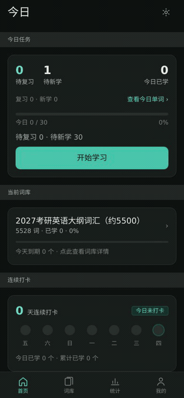
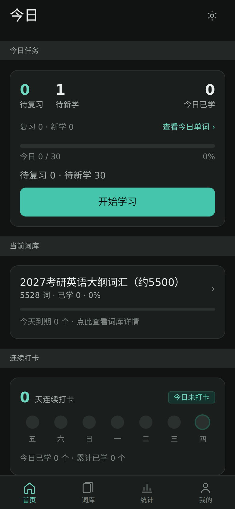
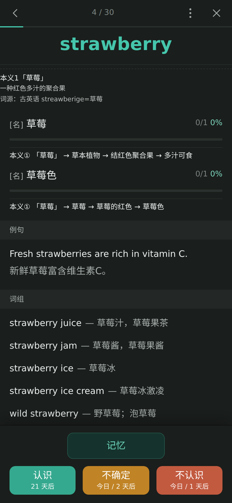
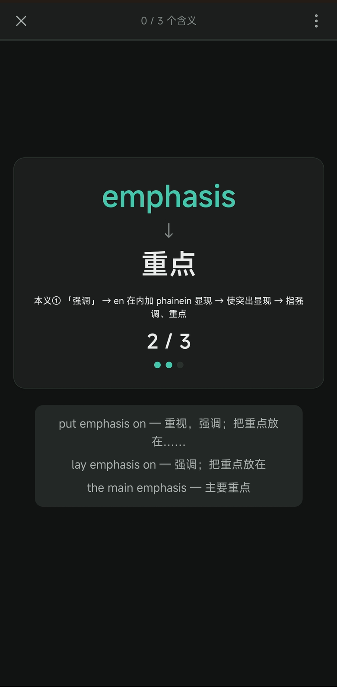
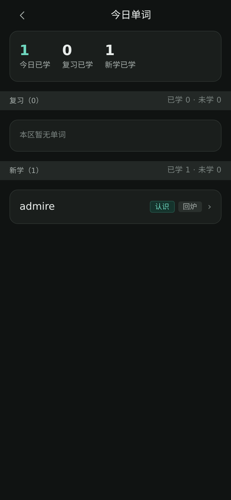
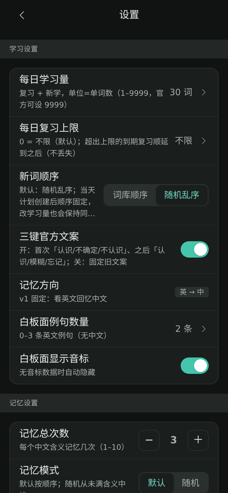
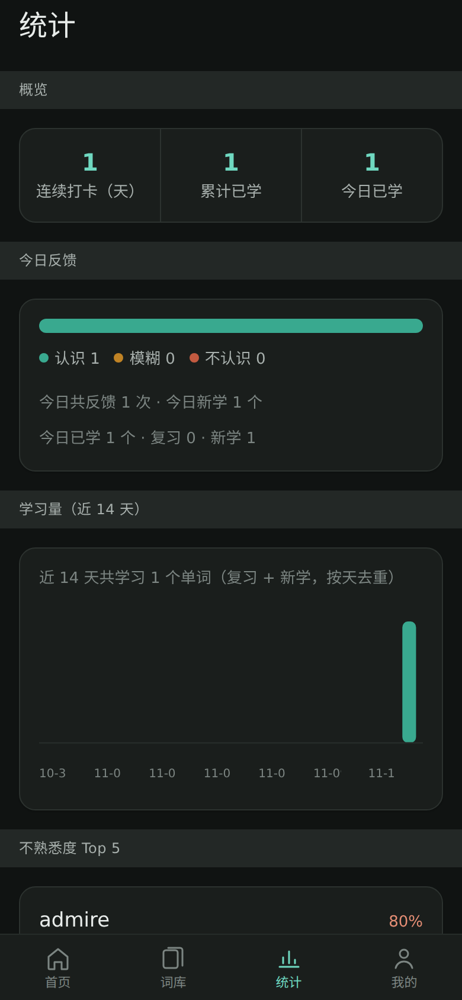

# WordC · 词到义

[](https://github.com/ChongCyrus/wordc/actions/workflows/ci.yml)
[](LICENSE)
[](https://web.dev/progressive-web-apps/)

> 许可概览：**代码 MIT** · **数据 CC BY-NC / CC BY-NC-SA（仅非商业）** — 详见 [THIRD-PARTY-NOTICES.md](THIRD-PARTY-NOTICES.md)

**英文单词 → 中文含义**的本地优先背单词 PWA：数据保存在本机 IndexedDB、离线可用、可安装到桌面。
界面与学习流程参考「墨墨背单词」**公开可观察的交互行为**设计，数值调度基于公开论文与公开数据近似实现。

> ## ⚠️ 合规与免责声明（请先读）
>
> - 本项目是**非官方、独立开源项目**，与「墨墨背单词」及其开发/运营方**没有任何隶属或合作关系**；
> - **仅限个人学习、非商业使用**；不得用于商业产品/服务；
> - 代码为独立实现，**未复制官方客户端代码**；界面按官方**公开可观察行为**做交互对齐，数值为公开公式近似，
>   **不承诺与官方逐词/逐值一致**；
> - **不使用**官方商标、图标、官方 App 截图或官方前端代码片段；仓库内含的素材均为本项目自制；
> - 内置词库与数据来自公开来源，许可见 [THIRD-PARTY-NOTICES.md](THIRD-PARTY-NOTICES.md)
>   （大纲词表 CC BY-NC-SA 4.0、官方难度数据 CC BY-NC 4.0、词组 BSD-3-Clause、ECDICT MIT，均需署名且**非商业**）；
> - 默认**不随仓库分发**受版权保护的商业词表（如红宝书）；需要的用户可自行导入自己的词库；
> - 「从墨墨导入」使用墨墨**官方开放 API** 与**你自己的 Token**（仅保存在本机），本项目不收集任何数据、不提供托管代理；
> - 本项目**不发布、不分发 APK**；如自行构建请使用自己的签名密钥。

## 演示

动图（约 15 秒，覆盖：首页 → 学习 → 记忆 → 三键 → 今日单词 → 设置）：



静态截图（390×844，深色主题）：

| 首页（今日 KPI 拆分） | 白板面（单词） | 注释面（不熟悉度条） | w→c 记忆（计数/词组） |
|---|---|---|---|
|  |  |  |  |

| 今日单词页 | 设置（新词顺序/复习上限） | 统计页 |
|---|---|---|
|  |  |  |

## 功能一览

- **学习**：每日队列（复习 + 新学预算）、三键反馈（认识 / 模糊 / 忘记）、当日进度与回炉、随时续学；
- **单词详情**：音标 / 多含义 / 例句 / 词组；每个含义可点击标记「不熟悉」；
- **w→c 多轮记忆**：单词 → 含义的全屏卡片，每个含义独立计数（默认 3 次），支持顺序/随机两种模式；
- **今日单词页**：复习 / 新学两分区（已学/未学、评分标签），点击词可看详情；
- **复习上限**：可设每日复习上限，超出部分顺延（不丢失），并显示积压提示；
- **回退与改判**：回退到上一词、重新选择评分（保留审计记录）；
- **任意学习量**：每日学习量 1–9999；
- **导入导出**：迁移包（含记忆状态与不熟悉度），可用于备份/换机；
- **PWA + 离线**：可安装、断网可用；可选自行构建 Android WebView 壳（APK）。

## 我们的创新点（写实、可验证）

1. **w→c 多轮记忆机制**：学习的核心不是「翻卡片」，而是「单词 → 每个中文含义」的多轮记忆卡片。
   每个含义（c）独立计数（默认 3 次），默认按顺序、也可随机；随机模式每次点击**立即从未满次数的 c 中重抽**，
   保证必收敛；「记忆」可随时重开一轮。
2. **按含义标记不熟悉 + 不熟悉度可视化**：注释面里每个含义都可点击标记；不熟悉度 = 点击次数 / 出现次数
   （clicks / encounters），用条形 + 颜色渐变呈现，并与统计页联动——这是「按含义粒度」而非「按单词」的学习反馈。
3. **三键语义与「今日进度」五档状态机**：三键文案（`N 天后` / `今日 / N 天后` / `今日进度 X%`）与标签切换按
   官方前端**公开可观察行为**对齐；「今日进度」用 5 档状态机实现（含同日转移表、完成判定），
   经本机实测样本验证主流程；**算法数值为公开论文公式近似，不承诺与官方逐词一致**。
4. **复习/新学拆分 + 今日单词页**：首页三 KPI（待复习/待新学/今日已学）与独立今日单词页；
   复习/新学预算、计划快照与顺延 backlog 均可在 UI 中直接看到。
5. **续学/回退/改判/任意学习量/词组按含义过滤**：当天计划持久化（退出重进同一队列）；
   回退后可改判（保留审计）；学习量 1–9999；w-c 页只显示**当前含义**有归属的词组（无归属的不硬猜，直接隐藏）。
6. **可迁移的完整学习状态**：导出迁移包包含记忆状态、不熟悉度、计划数据；换机/备份可完整恢复。
7. **本地优先 + PWA/APK 双形态**：学习数据只在本地；PWA 可离线安装；可选自建 Android WebView 壳。

> 说明：以上「创新点」指**本项目的工程实现与产品取舍**；其中与官方一致的部分仅限公开可观察的交互规则，
> 计算数值为近似，详见 [docs/FEATURES-COMPLIANCE.md](docs/FEATURES-COMPLIANCE.md)。

## 借鉴与边界（如实说明）

| 借鉴点 | 来源 | 我们的实现 | 边界 |
|---|---|---|---|
| 三键文案三态 + 标签切换 | 官方前端公开可观察行为（本机实测） | 按规则实现三态格式化与标签切换 | 交互对齐；数值近似 |
| 「今日进度」档位 | 官方 App 实机样本（受控采样） | 5 档状态机 + 转移表 | 主流程可复现；未观测边界为推断 |
| 复习调度（DHP / halflife） | 墨墨公开论文与开源实现（MIT） | 用公开公式重写，参数在 `src/core/params.ts` | 公式同源；不承诺逐词一致 |
| 复习/新学预算、每日学习量语义 | 官方帮助文档 | 复习全量（可选上限）+ 新学预算 = 学习量 − 入队复习 | 规则对齐 |
| 单词难度 | Dataverse 公开数据（CC BY-NC 4.0） | 内置难度 + 未覆盖回退 | 数据公开；MM-5 之后可能重训 |
| 「从墨墨导入」 | 墨墨官方开放 API | 用户自己的 Token + 本地代理（浏览器） | 功能保留；不公开未授权渠道细节 |

**我们没有做**：复制官方代码/素材、使用官方图标、内置商业词表、提供托管代理、收集用户 Token 或学习数据。

## 快速开始

```bash
pnpm install
pnpm dev        # http://127.0.0.1:5173
pnpm build      # 类型检查 + 生产构建（含 PWA service worker）
pnpm test       # 单元测试（离线，fake-indexeddb）
pnpm preview    # 预览构建产物（127.0.0.1:4173）
```

安装为 PWA：用 Chrome 打开 `pnpm preview` 的地址 → 菜单「安装应用 / 添加到主屏幕」。

## 从墨墨导入学习进度（可选）

- 使用墨墨**官方开放 API**，需要你自己的 Token（在墨墨网页版登录后获取）；Token 只保存于本机浏览器存储；
- 浏览器/PWA 受 CORS 限制，需要在本机运行代理：`node src/data/api/maimemo-proxy.mjs`，再在设置里填代理地址；
- 这是常规本地开发手段；本项目不提供在线代理、不收集/上传任何数据；
- 导入只写入本机数据库，可随时删除；建议先导出备份再导入。

## 内置词库与自定义词库

- 默认内置 **2027 考研英语大纲词库**（约 5528 词，含公开难度数据与开源词组数据）；
- 红宝书等商业词表**不随仓库分发**；请通过「导入词库」使用你自己的词表文件；
- **数据格式规范**：词库 `momo-deck` v1 / 迁移包 `momo-migration` v1（字段表、进度字段、checksum、版本兼容、隐私）见 [docs/DATA-FORMAT.md](docs/DATA-FORMAT.md)；
  算法/交互规格见 `docs/SPEC.md` / `docs/SPEC-v2.md`。

## 技术栈与架构

| 层 | 选型 |
|---|---|
| 构建 | Vite 5 + TypeScript 5（strict） |
| 视图 | React 18 + react-router-dom 6（HashRouter） |
| 样式 | Tailwind CSS 3 + CSS 变量主题（深色适配） |
| 存储 | Dexie 4（IndexedDB，本地优先） |
| PWA | vite-plugin-pwa 0.21（Workbox generateSW） |
| 测试 | Vitest 2（离线单测）+ Playwright 无头 E2E |
| 算法 | 纯 TS（`src/core/`），DHP/halflife 公开公式 |

架构与模块契约见 [docs/ARCH.md](docs/ARCH.md) / [docs/ARCH-v2.md](docs/ARCH-v2.md)；
算法规格见 [docs/SPEC.md](docs/SPEC.md) / [docs/SPEC-v2.md](docs/SPEC-v2.md)。

## 测试与 CI

- 单测全部离线（`fake-indexeddb`、mock 外部 API），无需 Token/网络；
- GitHub Actions（`.github/workflows/ci.yml`）：`static`（tsc）、`unit-core` / `unit-data` / `unit-ui`、
  `build`（产物 `pwa-dist`）、`e2e`（Playwright Chromium + 本地静态服务器跑 S1–S17 场景）；
- **CI 不构建/签名 APK**，不含任何签名密钥或 secrets；全部 job 只读运行。

## 本地构建 APK（可选，不发布）

公开仓**不发布 APK**，但包含 WebView 壳源码（`tools/apk/`：Java 壳、资源、`build-apk.sh` 与说明）。
如你需要 APK：按 [tools/apk/README.md](tools/apk/README.md) 自备 JDK/Android 工具链并**自行生成 keystore** 打包；
包名使用 `com.wordc.app`，并自行承担分发与合规责任。仓库不包含任何签名密钥、`toolchain/` 或构建产物。

## 数据与许可

- **代码**：[MIT](LICENSE)；
- **数据/素材**：见 [THIRD-PARTY-NOTICES.md](THIRD-PARTY-NOTICES.md)（CC BY-NC-SA 4.0 / CC BY-NC 4.0 /
  BSD-3-Clause / MIT 署名，**均限非商业**）；
- 若你是权利人并认为本仓库内容不当，请开 issue，我们会及时处理。

## FAQ

**Q：为什么和墨墨的间隔天数不完全一样？**
A：官方调度在服务端且未公开内部参数（记忆等级、per-word 参数等），我们用公开论文公式 + 公开难度数据近似，
交互规则对齐但数值不承诺逐词一致。

**Q：会拿走我的墨墨 Token 吗？**
A：不会。Token 仅存在你本机；导入请求由你的浏览器（经本地代理）或自建 APK 直连，项目不收集数据。

**Q：为什么默认词库没有红宝书？**
A：红宝书词表受版权保护，不随仓库分发；请导入你自己的词表。

**Q：可以商用/二次分发吗？**
A：代码 MIT 允许复用，但**数据多为非商业许可**（CC BY-NC 系列），整体仅限个人学习非商业使用。

**Q：和墨墨官方有关系吗？**
A：没有。非官方项目，不使用官方商标/素材；如有异议请通过 issue 联系。

**Q：第一次打开为什么内容会自己出现？**
A：公开版内置了**大纲词库**的例句/词组/助记/本义链内容包，首次启动自动导入本机（幂等，只导一次；
离线或加载失败会在下次启动重试）。内容仅存本机，不上传；你也可以自行导入/生成新的内容包。

## 贡献

欢迎 issue / PR（功能、算法校准、文档、测试）。请勿提交官方素材、商业词表、或任何 Token/密钥。
公开前请确保 `pnpm test` 与 `pnpm build` 通过，CI 保持全绿。

## English (brief)

WordC is a local-first, offline-capable English→Chinese vocabulary PWA. It keeps all study data in the
browser (IndexedDB), supports per-meaning familiarity tracking, a w→c multi-round memory flow, daily
review/new budgets with an optional review cap, resume/undo/re-rate, import/export of full study state,
and PWA installation. The public build bundles **dagang-only** content packs (examples/phrases/mnemonics/
core-sense semantics) which are imported once on first launch (local-only, retried offline). It is an **unofficial, non-commercial** project not affiliated with MaiMemo; UI
interaction rules follow publicly observable behavior, while scheduling values are approximations based on
public papers/data. Code is MIT; bundled data is non-commercial with attribution (see THIRD-PARTY-NOTICES).
