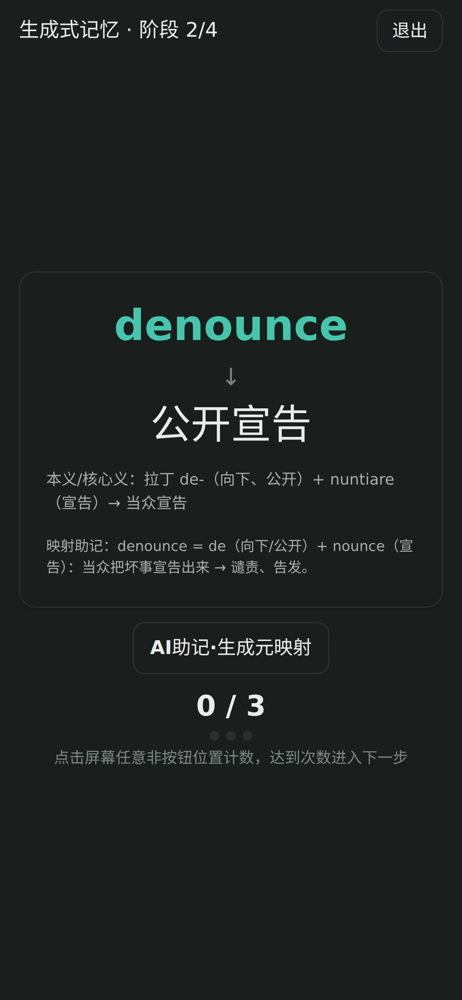
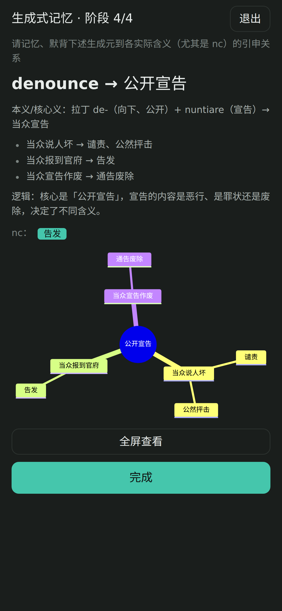
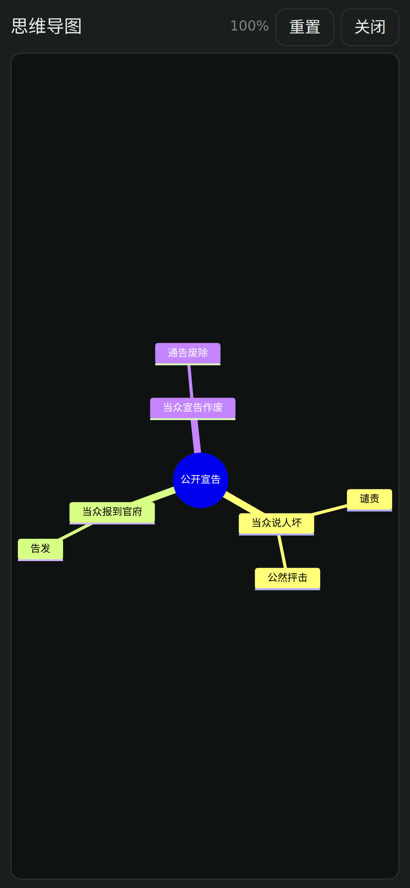
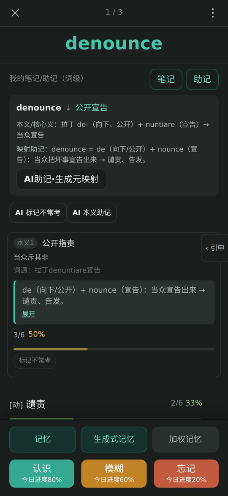
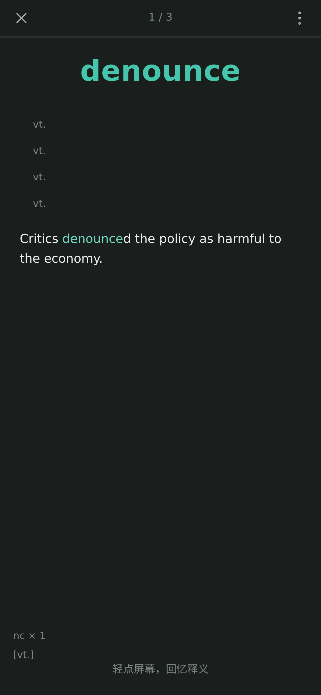
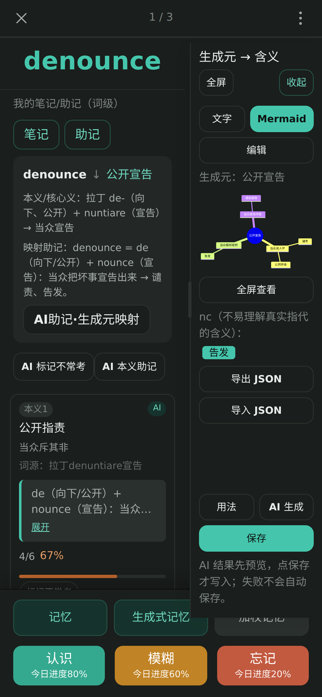
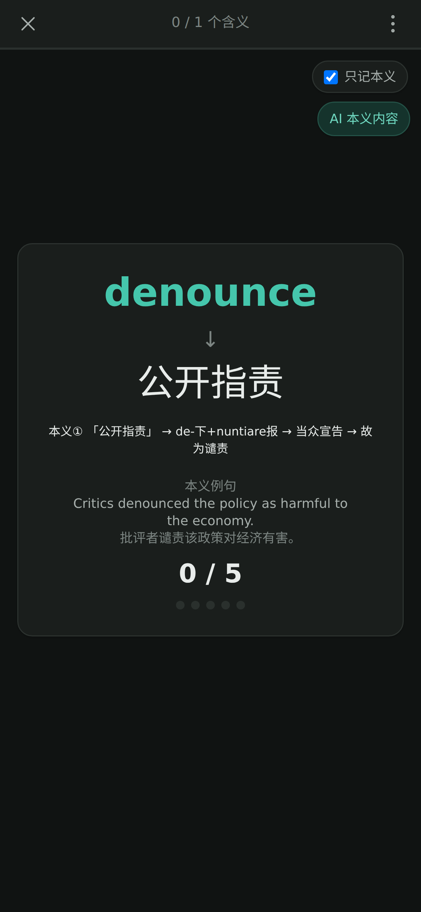
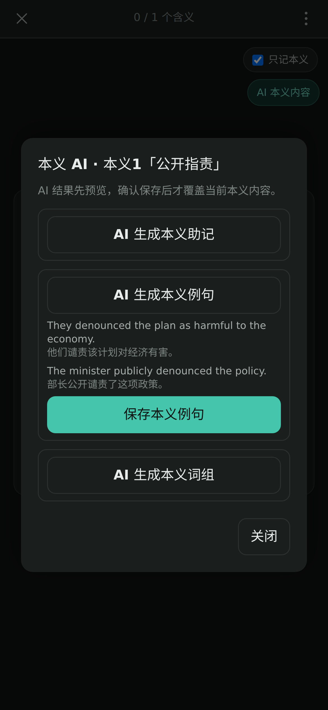
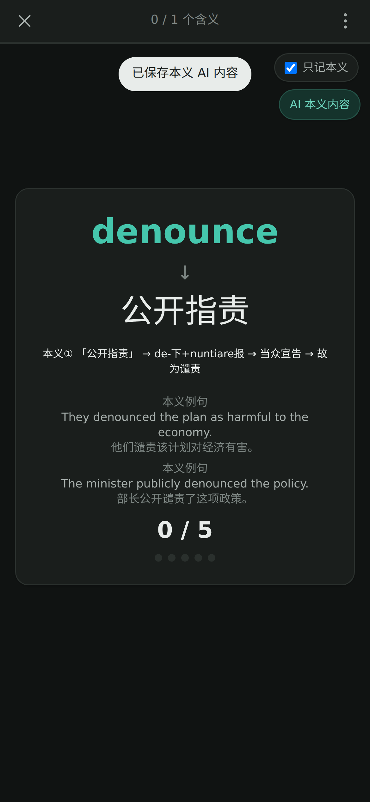
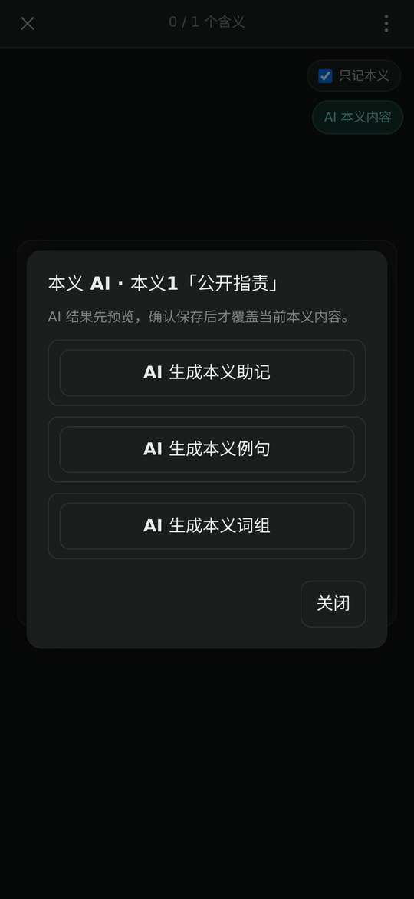

# WordC · 词到义

[](https://github.com/ChongCyrus/wordc/actions/workflows/ci.yml)
[](LICENSE)
[](https://web.dev/progressive-web-apps/)

> 许可概览：**代码 MIT** · **数据 CC BY-NC / CC BY-NC-SA（仅非商业）** — 详见 [THIRD-PARTY-NOTICES.md](THIRD-PARTY-NOTICES.md)

**英文单词 → 中文含义**的本地优先背单词 PWA：数据保存在本机 IndexedDB、离线可用、可安装到桌面。
界面与学习流程参考「墨墨背单词」**公开可观察的交互行为**设计，数值调度基于公开论文与公开数据近似实现。

> ## ⚠️ 合规与免责声明（请先读）
>
> - 本项目是**非官方、独立开源项目**，与「墨墨背单词」及其开发/运营方**没有任何隶属或合作关系**；
> - **仅限个人学习、非商业使用**；不得用于商业产品/服务；
> - 代码为独立实现，**未复制官方客户端代码**；界面按官方**公开可观察行为**做交互对齐，数值为公开公式近似，
>   **不承诺与官方逐词/逐值一致**；
> - **不使用**官方商标、图标、官方 App 截图或官方前端代码片段；仓库内含的素材均为本项目自制；
> - 内置词库与数据来自公开来源，许可见 [THIRD-PARTY-NOTICES.md](THIRD-PARTY-NOTICES.md)
>   （大纲词表 CC BY-NC-SA 4.0、官方难度数据 CC BY-NC 4.0、词组 BSD-3-Clause、ECDICT MIT，均需署名且**非商业**）；
> - 默认**不随仓库分发**受版权保护的商业词表（如红宝书）；需要的用户可自行导入自己的词库；
> - 「从墨墨导入」使用墨墨**官方开放 API** 与**你自己的 Token**（仅保存在本机），本项目不收集任何数据、不提供托管代理；
> - 本项目**不发布、不分发 APK**；如自行构建请使用自己的签名密钥。

## 用法与原理

### 使用方法及原理

基本流程：

记忆 → 回忆 → 点击标记不认识的 → 加权记忆 → 回忆 → 点击标记不认识的 → 加权记忆 …循环，直到所有（主要）含义映射都能回忆起来。

---

### 主推1：词根词缀法记忆流程：

1. 记忆 “词根缀源 → 词根缀源的含义”，及整体拼接后的含义/意象。
2. 在“加权记忆”模块里，用 词根缀源 理解、联系、推导 出 各个含义/本义（一些难导出的可试图构造逻辑，实在不行则直接接纳式地记忆）。

   <details>
   <summary>具体而言，......</summary>

   具体而言，可根据实际场景、词性、作用对象等推出、联系或理解 “词根缀源 → 各实际含义”，从而实现记忆。
   </details>
3. 之后白板页复习也是根据 词根缀源 来推导、回忆含义/本义，通过 “加权记忆”模块来针对未能想到的映射或含义/本义针对性记忆、加强巩固。

**总而言之**，本质原理就是建立记忆映射/实现映射的算法，从而转化为记忆这类算法。这样的好处是不易忘，“词 → 词根缀源” 是可以直接根据词本身构成得到的，于是通过 “词根缀源” 作为联想点/过渡来联想、推导得到 词义/本义 或确定 词义/本义的大方向 ，这样基本上不用刻意记或很容易记忆。

另一个好处是，即使忘记了词根词缀词源的含义，也可以尝试通过其它具有该词根词缀词源的单词来找共性、快速回忆起该词根词缀词源的含义。

注意：实际安排单词时建议使用字典序，这样可以一次性连续记忆同一或相近词根、词源的词，利于记忆、加深对词根印象。

---

### 主推2：生成式记忆：

记忆工作流：记忆单词到生成元的映射 → 理解生成元如何引申各个实际含义 → 代入生成元到各个含义的例句，看看是否可以理解各个含义的例句中该生成元的真实指代，找出那些不容易理解出真实指代的含义（记为 nc） → 记忆「通过生成元来得到各个实际含义（可只考虑那些 nc）」的关系网络（或者说使得可以仅通过生成元回忆起那些含义/nc）。

**具体而言：**

每次回忆时，建议从尽可能单个、最共性的本义出发，再按使用场景、作用对象、词性逐个引申出各个实际含义。记忆时同理：先找最共性的、底层的、尽可能统一的「生成元」（本义），再按场景/作用对象/词性引申得到各实际含义。

平时，如果生成元忘记了，我们也可以通过先根据相关记忆、它的已知道的一些含义来回忆起其生成元，进而再通过生成元来引申、回忆其它各实际含义。

主要原理：

大多或很多情形下，通过把核心义/词源代入实际语境或例句中就可以自然地理解出它的具体指代含义。

可以很容易地通过核心义/词源来引申得到其各种实际含义。

所以，一般只需记忆这个核心义/词源即可。而且，由于这个核心义/词源是各实际含义的共性，因此当忘记时也很容易通过所记住的几个实际含义来回忆起这个核心义/词源。

---

## 演示

> 截图来自生产包在 Chromium 中以 **390×844 逻辑尺寸 × 3 倍像素密度** 采集（1170×2532，深色主题，示例词 `denounce`），GIF 由连续帧合成。

### 生成式记忆（四阶段）

记忆路径：**单词 → 生成元 → 各实际含义（nc）→ 引申关系网络**。阶段 2 居中显示「单词 ↓ 生成元」并逐次点击计数，同时显示引申文字与可编辑的 AI 映射助记；阶段 4 默背生成元到各含义的引申关系，可直接看 Mermaid 思维导图。

| 阶段 2 · 点击计数 | 阶段 4 · 引申关系 | 阶段 4 · Mermaid |
| :---: | :---: | :---: |
|  |  |  |



### 注释面：生成元、本义与不熟悉度

注释面顶部是「生成元 → 各含义」映射与 AI 映射助记；每个本义是一张卡：标签、释义、词源、**点击即可标记不熟悉度**（百分比 + 进度条），并可「标记不常考」。白板底部提示 nc 词性，不直接显示中文。

| 白板：nc 仅词性 | 注释面：本义卡 + 不熟悉度 | 右半页：Mermaid 思维导图 |
| :---: | :---: | :---: |
|  |  |  |


### 只记本义加权记忆 + AI 本义内容

开启「只记本义」后，加权记忆只练本义；页面显示本义助记、代表例句、代表词组，右上角独立「AI 本义内容」可生成本义助记 / 例句 / 词组（先预览，确认后才写入）。

| 只记本义页 | AI 生成预览（例句） | 保存后立即显示 |
| :---: | :---: | :---: |
|  |  |  |



## 功能一览

- **生成式记忆（三阶段）**：注释面「生成式记忆」→ ① 记「单词 → 生成元」映射；② 代入生成元到各含义例句，点选不易理解真实指代的含义（nc）；③ 记「生成元 → 各含义/nc」关系网络。nc 持久化，注释面/w-c 显示 nc 标记；
- **本义体系**：每个含义（c）归属一棵「本义」；注释面把本义做成卡片（标签/释义/词源），点击标记不熟悉度并显示百分比与进度条；支持手动/AI 标记本义不常考（默认隐藏、可临时显示）；
- **只记本义加权记忆**：右上开关只练本义；w-c 页显示本义助记、代表例句、代表词组（数量可在设置调 0–3），右上独立「AI 本义内容」可生成本义助记/例句/词组，先预览、确认后才写入；本义 encounters 与 c 同机制；
- **生成元引申图**：注释面左滑/点「‹ 引申」打开右页，展示「生成元 → 按场景/对象/词性/抽象层级引申」的文字或 Mermaid 思维导图；支持编辑、全屏查看（缩放/平移/双击）、「用法」说明；AI 生成仅进预览，保存才写入本机；
- **批量生成引申图**：按词库/今日单词选词（默认排除已生成，单批上限 200），并发 1–4、进度/停止/失败重试；成功后保存本机，不覆盖 nc/用户内容/学习进度；
- **整屏 1:1 滑动**：注释面任意位置左滑打开右页并 1:1 跟手调宽（30–75%），短滑保持/松手小于 30% 关闭；设置→外观可调「右页滑动灵敏度」0.2–3.0×；
- **w-c 行联动**：w-c 顶部显示生成元；当前含义命中 AI 文字 lines 时显示对应「- 」行；注释面/右页显示 nc 与用户笔记/助记；
- **用户内容**：词级/含义级「我的笔记/助记」，AI 助记可编辑/隐藏/删除；导入导出包含用户内容与 nc；
- **学习**：每日队列（复习 + 新学预算）、三键反馈（认识 / 模糊 / 忘记）、当日进度与回炉、随时续学；
- **单词详情**：音标 / 多含义 / 例句 / 词组；每个含义可点击标记「不熟悉」；
- **w→c 多轮记忆**：单词 → 含义的全屏卡片，每个含义独立计数（默认 3 次），支持顺序/随机两种模式；
- **今日单词页**：复习 / 新学两分区（已学/未学、评分标签），点击词可看详情；
- **复习上限**：可设每日复习上限，超出部分顺延（不丢失），并显示积压提示；
- **回退与改判**：回退到上一词、重新选择评分（保留审计记录）；
- **任意学习量**：每日学习量 1–9999；
- **导入导出**：迁移包（含记忆状态与不熟悉度），可用于备份/换机；
- **PWA + 离线**：可安装、断网可用；需要 App 形态可自建 Android WebView 壳（[wordc-android-shell](https://github.com/ChongCyrus/wordc-android-shell)）。

## 我们的创新点（写实、可验证）

1. **w→c 多轮记忆机制**：学习的核心不是「翻卡片」，而是「单词 → 每个中文含义」的多轮记忆卡片。
   每个含义独立计数（默认 3 次），默认按顺序、也可随机；随机模式每次点击**立即从未满次数的 c 中重抽**，
   保证必收敛；「记忆」可随时重开一轮。
2. **按含义标记不熟悉 + 不熟悉度可视化**：注释面里每个含义都可点击标记；不熟悉度 = 点击次数 / 出现次数
   （clicks / encounters），用条形 + 颜色渐变呈现，并与统计页联动——这是「按含义粒度」而非「按单词」的学习反馈。
3. **三键语义与「今日进度」五档状态机**：三键文案（`N 天后` / `今日 / N 天后` / `今日进度 X%`）与标签切换按
   官方前端**公开可观察行为**对齐；「今日进度」用 5 档状态机实现（含同日转移表、完成判定），
   经本机实测样本验证主流程；**算法数值为公开论文公式近似，不承诺与官方逐词一致**。
4. **复习/新学拆分 + 今日单词页**：首页三 KPI（待复习/待新学/今日已学）与独立今日单词页；
   复习/新学预算、计划快照与顺延 backlog 均可在 UI 中直接看到。
5. **续学/回退/改判/任意学习量/词组按含义过滤**：当天计划持久化（退出重进同一队列）；
   回退后可改判（保留审计）；学习量 1–9999；w-c 页只显示**当前含义**有归属的词组（无归属的不硬猜，直接隐藏）。
6. **可迁移的完整学习状态**：导出迁移包包含记忆状态、不熟悉度、计划数据；换机/备份可完整恢复。
7. **本地优先 + PWA/APK 双形态**：学习数据只在本地；PWA 可离线安装；可选自建 Android WebView 壳。
8. **生成式记忆 + 生成元引申图**：把「记忆单词」转为「记忆单词→生成元映射」+「理解生成元如何按对象/场景/词性/抽象层级引申」+「生成元→各含义关系网络」三阶段；右页 AI 文字支持 `lines` 把每条 `- ` 行映射到含义，w-c 直接显示当前含义对应行。
9. **整屏 1:1 手势 + 灵敏度**：任意位置左滑 1:1 跟手开合/调宽（短滑保持、松手 <30 关闭），设置可调灵敏度；批量生成引申图支持选词/并发/停止/失败自动重试。

> 说明：以上「创新点」指**本项目的工程实现与产品取舍**；其中与官方一致的部分仅限公开可观察的交互规则，
> 计算数值为近似，详见 [docs/FEATURES-COMPLIANCE.md](docs/FEATURES-COMPLIANCE.md)。

## 借鉴与边界（如实说明）

| 借鉴点 | 来源 | 我们的实现 | 边界 |
|---|---|---|---|
| 三键文案三态 + 标签切换 | 官方前端公开可观察行为（本机实测） | 按规则实现三态格式化与标签切换 | 交互对齐；数值近似 |
| 「今日进度」档位 | 官方 App 实机样本（受控采样） | 5 档状态机 + 转移表 | 主流程可复现；未观测边界为推断 |
| 复习调度（DHP / halflife） | 墨墨公开论文与开源实现（MIT） | 用公开公式重写，参数在 `src/core/params.ts` | 公式同源；不承诺逐词一致 |
| 复习/新学预算、每日学习量语义 | 官方帮助文档 | 复习全量（可选上限）+ 新学预算 = 学习量 − 入队复习 | 规则对齐 |
| 单词难度 | Dataverse 公开数据（CC BY-NC 4.0） | 内置难度 + 未覆盖回退 | 数据公开；MM-5 之后可能重训 |
| 「从墨墨导入」 | 墨墨官方开放 API | 用户自己的 Token + 本地代理（浏览器） | 功能保留；不公开未授权渠道细节 |

**我们没有做**：复制官方代码/素材、使用官方图标、内置商业词表、提供托管代理、收集用户 Token 或学习数据。

## 快速开始

```bash
pnpm install
pnpm dev        # http://127.0.0.1:5173
pnpm build      # 类型检查 + 生产构建（含 PWA service worker）
pnpm test       # 单元测试（离线，fake-indexeddb）
pnpm preview    # 预览构建产物（127.0.0.1:4173）
```

安装为 PWA：用 Chrome 打开 `pnpm preview` 的地址 → 菜单「安装应用 / 添加到主屏幕」。

## 从墨墨导入学习进度（可选）

- 使用墨墨**官方开放 API**，需要你自己的 Token（在墨墨网页版登录后获取）；Token 只保存于本机浏览器存储；
- 浏览器/PWA 受 CORS 限制，需要在本机运行代理：`node src/data/api/maimemo-proxy.mjs`，再在设置里填代理地址；
- 这是常规本地开发手段；本项目不提供在线代理、不收集/上传任何数据；
- 导入只写入本机数据库，可随时删除；建议先导出备份再导入。

## 内置词库与自定义词库

- 默认内置 **2027 考研英语大纲词库**（约 5528 词，含公开难度数据与开源词组数据）；
- 红宝书等商业词表**不随仓库分发**；请通过「导入词库」使用你自己的词表文件；
- **数据格式规范**：词库 `momo-deck` v1 / 迁移包 `momo-migration` v1（字段表、进度字段、checksum、版本兼容、隐私）见 [docs/DATA-FORMAT.md](docs/DATA-FORMAT.md)；
  算法/交互规格见 `docs/SPEC.md` / `docs/SPEC-v2.md`。

## 技术栈与架构

| 层 | 选型 |
|---|---|
| 构建 | Vite 5 + TypeScript 5（strict） |
| 视图 | React 18 + react-router-dom 6（HashRouter） |
| 样式 | Tailwind CSS 3 + CSS 变量主题（深色适配） |
| 存储 | Dexie 4（IndexedDB，本地优先） |
| PWA | vite-plugin-pwa 0.21（Workbox generateSW） |
| 测试 | Vitest 2（离线单测）+ Playwright 无头 E2E |
| 算法 | 纯 TS（`src/core/`），DHP/halflife 公开公式 |

架构与模块契约见 [docs/ARCH.md](docs/ARCH.md) / [docs/ARCH-v2.md](docs/ARCH-v2.md)；
算法规格见 [docs/SPEC.md](docs/SPEC.md) / [docs/SPEC-v2.md](docs/SPEC-v2.md)。

## 测试与 CI

- 单测全部离线（`fake-indexeddb`、mock 外部 API），无需 Token/网络；
- GitHub Actions（`.github/workflows/ci.yml`）：`static`（tsc）、`unit-core` / `unit-data` / `unit-ui`、
  `build`（产物 `pwa-dist`）、`e2e`（Playwright Chromium + 本地静态服务器跑 S1–S17 场景）；
- **CI 不构建/签名 APK**，不含任何签名密钥或 secrets；全部 job 只读运行。

## 本地构建 APK（可选，不发布）

公开仓**不发布 APK**，也不包含 APK 壳源码；壳已独立到单独仓库：
**[wordc-android-shell](https://github.com/ChongCyrus/wordc-android-shell)**（WebView 容器、原生 SQLite 桥、`build-apk.sh`）。

如你需要 APK：

```bash
git clone https://github.com/ChongCyrus/wordc && cd wordc && pnpm install && pnpm build
git clone https://github.com/ChongCyrus/wordc-android-shell && cd wordc-android-shell
PWA_DIST_BASE=/path/to/wordc bash build-apk.sh
```

按该仓库 README 自备 JDK / Android 工具链并**自行生成 keystore**；包名建议改为自己的（不要用作者的包名），
并自行承担分发与合规责任。两个仓库都不包含任何签名密钥、`toolchain/` 或构建产物。

## 数据与许可

- **代码**：[MIT](LICENSE)；
- **数据/素材**：见 [THIRD-PARTY-NOTICES.md](THIRD-PARTY-NOTICES.md)（CC BY-NC-SA 4.0 / CC BY-NC 4.0 /
  BSD-3-Clause / MIT 署名，**均限非商业**）；
- 若你是权利人并认为本仓库内容不当，请开 issue，我们会及时处理。

## FAQ

**Q：为什么和墨墨的间隔天数不完全一样？**
A：官方调度在服务端且未公开内部参数（记忆等级、per-word 参数等），我们用公开论文公式 + 公开难度数据近似，
交互规则对齐但数值不承诺逐词一致。

**Q：会拿走我的墨墨 Token 吗？**
A：不会。Token 仅存在你本机；导入请求由你的浏览器（经本地代理）或自建 APK 直连，项目不收集数据。

**Q：为什么默认词库没有红宝书？**
A：红宝书词表受版权保护，不随仓库分发；请导入你自己的词表。

**Q：可以商用/二次分发吗？**
A：代码 MIT 允许复用，但**数据多为非商业许可**（CC BY-NC 系列），整体仅限个人学习非商业使用。

**Q：和墨墨官方有关系吗？**
A：没有。非官方项目，不使用官方商标/素材；如有异议请通过 issue 联系。

**Q：第一次打开为什么内容会自己出现？**
A：公开版内置了**大纲词库**的例句/词组/助记/本义链内容包，首次启动自动导入本机（幂等，只导一次；
离线或加载失败会在下次启动重试）。内容仅存本机，不上传；你也可以自行导入/生成新的内容包。

## 贡献

欢迎 issue / PR（功能、算法校准、文档、测试）。请勿提交官方素材、商业词表、或任何 Token/密钥。
公开前请确保 `pnpm test` 与 `pnpm build` 通过，CI 保持全绿。

## English (brief)

WordC is a local-first, offline-capable English→Chinese vocabulary PWA. It keeps all study data in the
browser (IndexedDB), supports per-meaning familiarity tracking, a w→c multi-round memory flow, daily
review/new budgets with an optional review cap, resume/undo/re-rate, import/export of full study state,
and PWA installation. The public build bundles **dagang-only** content packs (examples/phrases/mnemonics/
core-sense semantics) which are imported once on first launch (local-only, retried offline). It is an **unofficial, non-commercial** project not affiliated with MaiMemo; UI
interaction rules follow publicly observable behavior, while scheduling values are approximations based on
public papers/data. Code is MIT; bundled data is non-commercial with attribution (see THIRD-PARTY-NOTICES).
